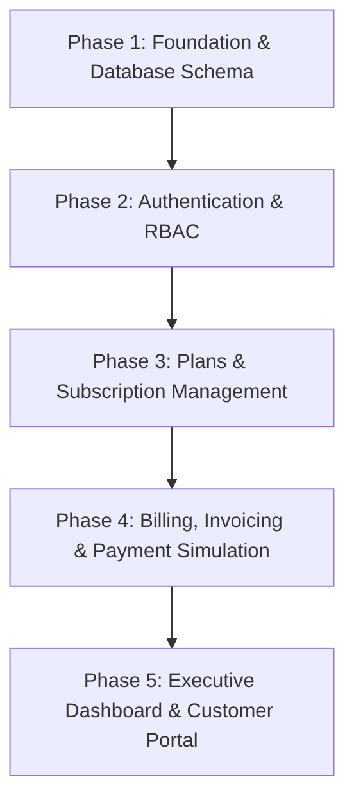

# Implementation Roadmap: Subscription Management System

## Milestone 1: Production-Ready MVP

### Phase Breakdown

---

### Phase 1: Project Foundation, Core Architecture & Database Schema
**Goal:** Establish clean workspace structure, Express + TypeScript API server, Prisma ORM schema, and automated database migration/seeding.

- [ ] Initialize frontend (`frontend/` with Vite + React + TypeScript + Tailwind CSS) and backend (`backend/` with Express + TypeScript).
- [ ] Define Prisma ORM schema covering:
  - `User` (email, passwordHash, role: `ADMIN` | `CUSTOMER`)
  - `Customer` (name, email, company, address, phone)
  - `Plan` (name, description, price, interval: `MONTHLY` | `YEARLY`, isActive, features)
  - `Subscription` (customerId, planId, status: `ACTIVE` | `PENDING` | `CANCELLED` | `EXPIRED`, currentPeriodStart, currentPeriodEnd)
  - `Invoice` (invoiceNumber, customerId, subscriptionId, subtotal, taxAmount, discountAmount, total, status: `DRAFT` | `UNPAID` | `PAID` | `OVERDUE`, dueDate)
  - `InvoiceItem` (description, unitPrice, quantity, amount)
  - `Payment` (invoiceId, amount, paymentMethod, transactionRef, paidAt)
- [ ] Create database migration and automated seed script (`backend/prisma/seed.ts`).
- [ ] Implement Express error handling middleware and health check endpoint (`GET /api/health`).
- [ ] **Verification Criteria:**
  - `npm run build` succeeds on both backend and frontend.
  - `npx prisma db push` (or migrate) initializes database cleanly.
  - `npm run seed` creates default Admin and initial demo records.
  - Health endpoint returns `{ status: "ok", timestamp: ... }`.

---

### Phase 2: Authentication Engine & Role-Based Access Control
**Goal:** Deliver secure authentication, token management, and role-based route protection for both API and UI.

- [ ] Implement password hashing utility (`bcrypt`) and JWT token service (sign, verify).
- [ ] Build Auth API routes:
  - `POST /api/auth/login` (validates credentials, returns JWT & user profile)
  - `POST /api/auth/register-customer` (Admin or self-service customer registration)
  - `GET /api/auth/me` (returns current user context and linked customer profile)
- [ ] Implement Express middleware:
  - `authenticateToken`: validates bearer token and sets `req.user`.
  - `requireRole('ADMIN' | 'CUSTOMER')`: enforces RBAC on sensitive routes.
- [ ] Build Frontend Auth:
  - `AuthContext` to persist tokens, current user, and authentication state.
  - Login view with toggleable quick-login buttons for Demo Admin and Demo Customer.
  - Protected Route guards redirecting unauthorized users.
- [ ] **Verification Criteria:**
  - Login with Admin credentials succeeds and redirects to Admin layout.
  - Login with Customer credentials redirects to Customer Portal layout.
  - Attempting to access Admin routes with Customer token returns HTTP 403.
  - Attempting unauthenticated access returns HTTP 401.

---

### Phase 3: Plans & Subscription Management Engine
**Goal:** Implement full lifecycle management for pricing tiers and customer subscriptions with automated renewal date logic.

- [ ] Implement Plans API:
  - `GET /api/plans`: list active plans (public/customer) or all plans (admin).
  - `POST /api/plans`: create a new plan (Zod validation for price, interval, features).
  - `PUT /api/plans/:id`: update plan details.
  - `PATCH /api/plans/:id/toggle`: toggle active/inactive status.
- [ ] Implement Customer & Subscription API:
  - `GET /api/customers`: list customers with subscription summary.
  - `POST /api/customers`: create customer record.
  - `POST /api/subscriptions`: subscribe customer to plan with automated `currentPeriodEnd` calculation (`+1 month` or `+1 year`).
  - `PATCH /api/subscriptions/:id/status`: cancel or update subscription status.
- [ ] Build Frontend Plan Management:
  - Responsive Plan cards and table displaying pricing, interval badges, and features.
  - "New Plan" modal with interval selector and feature list inputs.
  - Status toggle switch (Active/Inactive).
- [ ] Build Frontend Subscription Management:
  - Customer directory with active plan indicators.
  - "Assign Subscription" flow to select customer and active plan.
  - Subscription details drawer/modal with cancellation controls.
- [ ] **Verification Criteria:**
  - Create a new "Growth" plan at $79/month.
  - Create a new customer "Starlight Inc" and subscribe them to "Growth".
  - Verify subscription is marked `ACTIVE` with `currentPeriodEnd` set exactly 1 month forward.

---

### Phase 4: Billing, Invoicing & Simulated Payments
**Goal:** Build itemized invoice calculation, status lifecycle, and simulated payment reconciliation.

- [ ] Implement Billing & Invoicing Service:
  - Automatic invoice creation upon subscription generation.
  - Calculation logic: `subtotal`, `taxAmount` (configurable percentage), `discountAmount`, `total`.
  - Unique sequential invoice number generation (e.g. `INV-2026-0001`).
- [ ] Implement Invoices API:
  - `GET /api/invoices`: list invoices with status filters (`ALL`, `UNPAID`, `PAID`, `OVERDUE`).
  - `GET /api/invoices/:id`: retrieve full itemized invoice details with payments.
  - `POST /api/invoices/:id/payments`: record simulated payment (amount, method, transaction reference).
- [ ] Invoice State Automation:
  - When payment amount reaches invoice total, auto-transition status from `UNPAID` to `PAID`.
  - Mark invoices past due date as `OVERDUE`.
- [ ] Build Frontend Invoices View:
  - Invoices data table with status pill badges and search/filter.
  - Detailed Invoice View modal showing customer billing details, line items, taxes, and balance.
  - "Record Payment" modal with payment method selector (Credit Card, Bank Transfer, Demo Simulator) and amount verification.
- [ ] **Verification Criteria:**
  - Subscription creation automatically produces an `UNPAID` invoice with accurate calculations.
  - Record payment equal to total amount -> invoice status changes to `PAID`.
  - Payment record appears in invoice payment history with transaction reference.

---

### Phase 5: Executive Dashboard, Metrics & Customer Portal Experience
**Goal:** Deliver the executive analytics dashboard for business administrators and the self-service portal for subscribers, backed by realistic demo seed data.

- [ ] Implement Dashboard Stats API (`GET /api/dashboard/stats`):
  - Total Customers count.
  - Active Subscriptions count.
  - Monthly Recurring Revenue (MRR) calculated across monthly and annualized yearly plans.
  - Unpaid and Overdue invoices total value and count.
  - Upcoming renewals list (within 7 and 30 days).
  - Recent activity event log (subscriptions created, payments recorded).
- [ ] Build Admin Executive Dashboard UI:
  - Metric summary cards with trends and icons.
  - Visual breakdown of subscription distributions by plan.
  - Urgent alerts panel for overdue invoices and upcoming renewals.
  - Quick action shortcuts (New Plan, New Customer, New Subscription).
- [ ] Build Customer Self-Service Portal (`/portal`):
  - Current Plan banner with status, price, interval, and next renewal countdown.
  - Customer Invoice History with downloadable/printable invoice view.
- [ ] Polish Seed Data & Demo Experience:
  - Rich dataset with multiple customers, mixed plan tiers, active/overdue subscriptions, and past payments.
  - One-click demo credentials banner for hackathon presentation.
- [ ] **Verification Criteria:**
  - Dashboard displays accurate live metrics that update dynamically when plans or subscriptions are created.
  - Switching to Customer account shows their individual subscription and invoice history only.
  - Complete end-to-end demonstration flow passes seamlessly.
